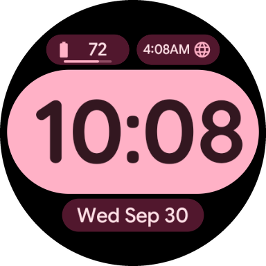
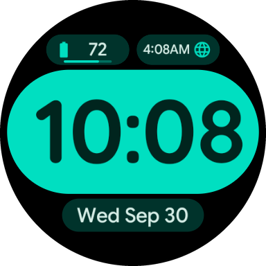
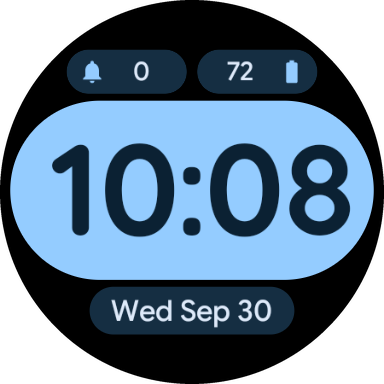
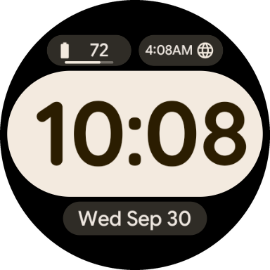
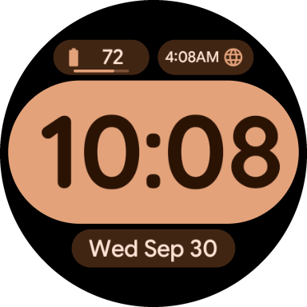

# MinimalFace

A minimal digital watch face for Wear OS, built entirely with the declarative
[Watch Face Format](https://developer.android.com/training/wearables/wff) (no code).

<p align="center">
  
  
  
  
  
</p>

- Big, bold time inside a full-color pill, with a blinking colon
- Date pill and two complications (short text, ranged value, goal progress, icons)
  with progress bars
- 16 color themes, selectable from the watch face editor
- Low-power Always-On mode with outlined pills

**Requires:** Wear OS 6 or later (API 36, Watch Face Format v4).

## Color themes

The background is always black. Each theme has an hour pill color, darker digits in
the same hue, and a deep tone for the date and complication pills.

| # | Theme | Hour pill / accent | Hour digits | Date & complication pills | Text |
|---|-------|--------------------|-------------|---------------------------|------|
| 0 | Neon Plum | `#FFB1C6` | `#331720` | `#51172D` | `#FFE1E7` |
| 1 | Electric Berry | `#BF86FF` | `#0C0319` | `#391E58` | `#F1E3F9` |
| 2 | Sunset Apricot | `#FFB59C` | `#34180E` | `#511A05` | `#FFE2D9` |
| 3 | Cyber Punk Amber | `#FFB952` | `#2E1C02` | `#3F2700` | `#FEE4C6` |
| 4 | Mint Cyan | `#00DFC1` | `#00251E` | `#00332B` | `#D6EDE6` |
| 5 | Emerald Sky | `#75DAA8` | `#072517` | `#133223` | `#D9EDDF` |
| 6 | Pastel Lavender & Butter | `#E1B6FF` | `#281A31` | `#39224A` | `#F3E3F8` |
| 7 | Arctic Glacier | `#94CCFF` | `#0B2133` | `#152E42` | `#DDE9F9` |
| 8 | Cloud Dancer | `#F3EADF` | `#2B1D01` | `#2F2C26` | `#EEE7E0` |
| 9 | Lagoon | `#60D7E5` | `#002428` | `#0B3135` | `#D6ECF0` |
| 10 | Clay | `#E3A27A` | `#2B1304` | `#412513` | `#FEE3D5` |
| 11 | Sage | `#BACE98` | `#192309` | `#272F1A` | `#E7EADA` |
| 12 | Lemon Zing | `#E2C633` | `#261F02` | `#342C01` | `#F2E8C6` |
| 13 | Cobalt | `#8EA0FF` | `#050920` | `#202954` | `#E6E7FC` |
| 14 | Fresh Green | `#9ADF62` | `#16230B` | `#1C3209` | `#E1ECD2` |
| 15 | Pine | `#68B071` | `#000A02` | `#16321A` | `#DCEDD8` |

The palettes are generated from Material 3 (HCT) seeds with `tools/generate_themes.py`.

## Build and install

```bash
./gradlew :watchface:assembleRelease
adb install watchface/build/outputs/apk/release/watchface-release.apk
```

## License

The code and assets are released under the [MIT License](LICENSE),
© 2026 Francesco Chiaramonte.

The bundled fonts are licensed separately under the
[SIL Open Font License 1.1](https://openfontlicense.org); their copyright notices and
license texts are in [`licenses/fonts/`](licenses/fonts/).

| Font file | Font | Copyright |
|-----------|------|-----------|
| `quicksand.ttf` | Quicksand | The Quicksand Project Authors |
| `google_sans_flex.ttf` | Google Sans Flex | The Google Sans Flex Authors |
| `robotoflex_numeral.ttf` | Roboto Flex | The Roboto Flex Project Authors |
| `questrial.ttf` | Questrial | The Questrial Project Authors |
| `concert_one.ttf` | Concert One | Johan Kallas, Mihkel Virkus |
