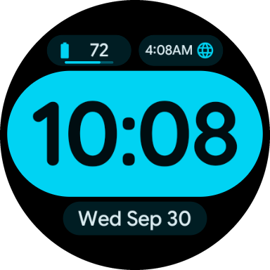
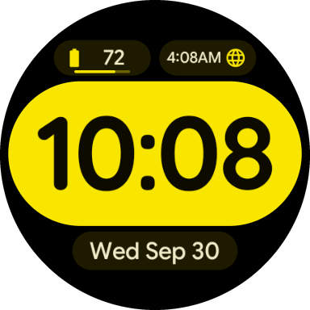
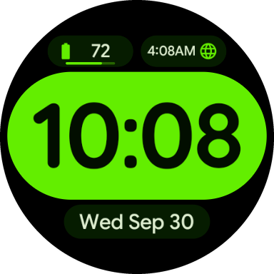

# MinimalFace

A minimal digital watch face for Wear OS, built entirely with the declarative
[Watch Face Format](https://developer.android.com/training/wearables/wff) (no code).

<p align="center">
  
  
  
  
  
</p>

- Big, bold time inside a full-color pill, with a blinking colon
- Date pill and two complications (short text, ranged value, goal progress, icons)
  with progress bars
- 18 color themes, selectable from the watch face editor
- Low-power Always-On mode with outlined pills

**Requires:** Wear OS 6 or later (API 36, Watch Face Format v4).

## Color themes

The background is always black. Each theme has an hour pill color, near-black digits tinted in
the same hue, and a deep tone for the date and complication pills.

| # | Theme | Hour pill / accent | Hour digits | Date & complication pills | Text |
|---|-------|--------------------|-------------|---------------------------|------|
| 0 | Neon Plum | `#FFA2BC` | `#20000B` | `#3A0219` | `#FFE1E7` |
| 1 | Electric Berry | `#BA7CFF` | `#140129` | `#270647` | `#F1E3F9` |
| 2 | Neon Rose | `#FF7198` | `#200009` | `#380014` | `#FFE1E5` |
| 3 | Acid Yellow | `#F8E600` | `#0D0B00` | `#1D1A00` | `#EFE9C8` |
| 4 | Mint Cyan | `#00D8BA` | `#000E0A` | `#001E18` | `#D6EDE5` |
| 5 | Scarlet | `#FF8073` | `#200101` | `#370303` | `#FFE2DE` |
| 6 | Fuchsia | `#FF6CEA` | `#1D001A` | `#360631` | `#FCE1F1` |
| 7 | Arctic Glacier | `#7CC3FF` | `#000C18` | `#001B2F` | `#DDEAF9` |
| 8 | Cloud Dancer | `#F3EADF` | `#110A00` | `#2F2C26` | `#EEE7E0` |
| 9 | Electric Cyan | `#00D3F3` | `#000D11` | `#001D23` | `#DAEBF0` |
| 10 | Tangerine | `#FF834E` | `#1B0400` | `#370E00` | `#FFE2D8` |
| 11 | Mocha | `#CA9570` | `#170700` | `#2C1606` | `#FDE3D4` |
| 12 | Lemon Zing | `#E2C633` | `#0E0B00` | `#342C01` | `#F2E8C6` |
| 13 | Cobalt | `#8498FF` | `#00062F` | `#011151` | `#E6E7FC` |
| 14 | Toxic Green | `#63EE00` | `#020E00` | `#061C00` | `#DEEDD0` |
| 15 | Pine | `#3FB868` | `#000E03` | `#001F0A` | `#DBEDDA` |
| 16 | Matcha | `#B2C428` | `#0A0C00` | `#181C00` | `#E9EACB` |
| 17 | Seafoam | `#58DAA2` | `#000E07` | `#001F12` | `#D8EDDF` |

The palettes are generated from Material 3 (HCT) seeds.

## Install

Download the latest APK from [Releases](https://github.com/keeara/MinimalFace/releases/latest) and sideload it:

```bash
adb install MinimalFace-1.2.3.apk
```

## Build from source

```bash
./gradlew :watchface:assembleRelease
adb install watchface/build/outputs/apk/release/watchface-release.apk
```

## License

The code and assets are released under the [MIT License](LICENSE),
© 2026 Francesco Chiaramonte.

The bundled fonts are licensed separately under the
[SIL Open Font License 1.1](https://openfontlicense.org); their copyright notices and
license texts are in [`licenses/fonts/`](licenses/fonts/).

| Font file | Font | Copyright |
|-----------|------|-----------|
| `quicksand.ttf` | Quicksand | The Quicksand Project Authors |
| `google_sans_flex.ttf` | Google Sans Flex | The Google Sans Flex Authors |
| `robotoflex_numeral.ttf` | Roboto Flex | The Roboto Flex Project Authors |
| `questrial.ttf` | Questrial | The Questrial Project Authors |
| `concert_one.ttf` | Concert One | Johan Kallas, Mihkel Virkus |
